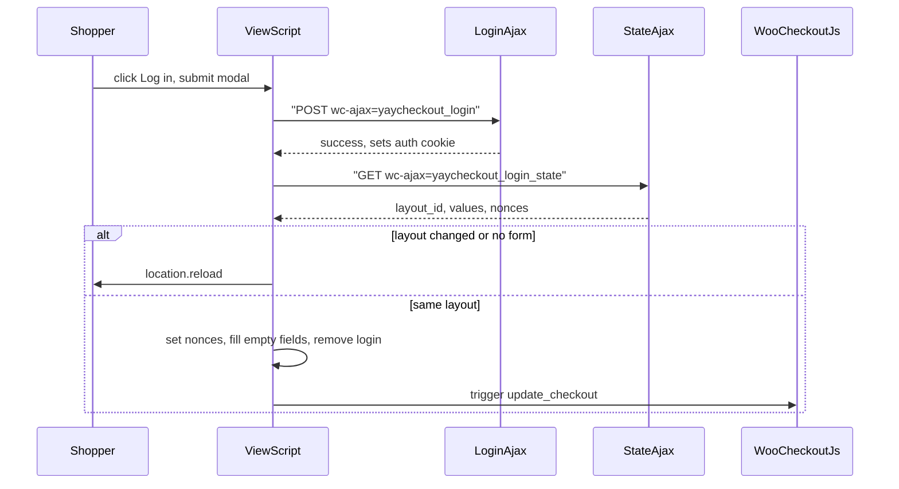

# Checkout login block Implementation Plan

> **For agentic workers:** executed 2026-10-06. The storefront checks in each task were not run in a browser.

**Status:** done 2026-10-06
**Goal:** Khách chưa đăng nhập thấy lời nhắc login trên checkout YayCheckout và đăng nhập được mà không mất chỗ đang điền.
**Spec:** none, planned from the request
**Architecture:** Block động mới `yaycheckout/login` theo khung của Contact và Place order: `block.json`, `edit.tsx`, `render.php`, cộng `view.ts` và `style.scss`. Modal là `<dialog>` lấy từ một `<template>`, gắn vào `document.body`. Nhờ đó form login của nó không lồng trong `<form name="checkout">`; HTML parser cho phép `<form>` trong `<template>`. Đăng nhập qua hai endpoint wc-ajax: một endpoint gọi `wp_signon()`, một endpoint khác chạy ở request sau (đã có cookie) trả nonce mới, giá trị tài khoản và id layout. Không thay HTML của form, nên listener của `checkout.js` và các cổng thanh toán còn nguyên.
**Touches:** `packages/blocks/src/login/*` (mới), `packages/blocks/src/checkout/render.php`, `includes/Renderer/CheckoutLogin.php` (mới), `includes/YayCheckout.php`, `includes/Blocks/BlockRegistry.php`, `docs/architecture.md`, `docs/backlog/2026-10-05-account-fields-and-checkout-form-hooks-never-render.md`
**Tests:** none. Login không thuộc các trường hợp mà rule test trong CLAUDE.md liệt kê; mỗi task có bước kiểm tra tay với kết quả cụ thể.

## Requirements

- **Goal:** Khách chưa đăng nhập thấy câu nhắc trên checkout; bấm đoạn link thì sang trang login hoặc mở modal, tùy cách merchant đặt trên block.
- **Out of scope:** account fields hoặc "Create an account?", coupon, order notes, bắn `woocommerce_before_checkout_form`, tự thêm block vào `default_markup()`, giới hạn số lần thử đăng nhập.
- **Acceptance criteria:**
  1. Option `woocommerce_enable_checkout_login_reminder` khác `yes`, hoặc khách đã đăng nhập: block không in gì trên storefront.
  2. Câu mặc định là `Returning customers? Log in`, và chỉ đoạn `Log in` (attribute `linkText`) nhận click. `linkText` không có trong câu thì in cả câu, rồi thêm link ở cuối.
  3. Behavior `page`: link trỏ tới `wp_login_url( wc_get_checkout_url() )`; đăng nhập xong quay về checkout.
  4. Behavior `modal`: sai mật khẩu thì modal vẫn mở và hiện lỗi; trang không tải lại.
  5. Đăng nhập modal đúng, layout không đổi: chữ khách đã gõ còn nguyên, ô trống được điền từ tài khoản, dòng login biến mất, tổng tiền cập nhật, Place order đặt được hàng.
  6. Layout sau đăng nhập khác layout đang hiện (Pro, rule `login_status`), hoặc trang chưa có form: trang tải lại.
  7. Guest checkout tắt, registration at checkout tắt, option bật: trên câu "You must be logged in to checkout." có lời nhắc login; dùng block login của layout nếu có, không thì dùng mặc định. Đăng nhập xong form đặt hàng hiện ra.
  8. End-to-end: layout có block Login (modal), guest điền họ, mở modal, đăng nhập tài khoản có địa chỉ, đặt hàng thành công; trong wp-admin, đơn thuộc tài khoản đó.
- **Decided with the user:** sau login giữ form và chỉ tải lại khi layout đổi hoặc chưa có form; nhánh "must be logged in" xử lý trong task này; không thêm block vào layout mặc định; làm cả hai behavior, merchant chọn trên block.

## Global constraints

- PHP sản phẩm phải chạy trên PHP 7.4: không enum, `match`, `readonly`, promoted constructor properties, `?->`, named arguments, union types.
- Không sửa tay `assets/dist/`, `vendor/`, `vendor-prefixed/`, `release/`. Sửa `packages/blocks/src/login/`, rồi chạy `pnpm build:blocks`.
- Không file mới nào nhắc `YayCheckout\Pro`; tính năng có ở Free.
- Option key của Woo là hằng số trên class sở hữu (`CheckoutLogin::OPTION_REMINDER`), không viết chuỗi rời.
- Trường gửi qua wire là snake_case.
- Branch `<name>/feat/checkout-login-block` từ `dev/edd`; commit theo Conventional Commits, có trailer Co-Authored-By; stage từng file theo tên.

## Review focus

- Đặt hàng sau khi đăng nhập modal: nonce `woocommerce-process_checkout` và `update-order-review` cũ đã chết. Task 4 Step 3 kiểm tra Place order.
- Ô khách đã gõ không bị ghi đè bằng dữ liệu tài khoản. Task 4 Step 3.
- Plugin captcha hoặc 2FA gắn vào `woocommerce_login_form`: field của nó phải được gửi theo, và lỗi của nó (`woocommerce_process_login_errors`) phải hiện trong modal. Task 3 Step 3.
- Option tắt: storefront không còn dấu vết; editor vẫn hiện block để chỉnh. Task 1 Step 4.

---

### Task 1: Block `yaycheckout/login`, behavior `page`

**Files:**
- Create: `packages/blocks/src/login/block.json`, `index.ts`, `edit.tsx`, `render.php`, `style.scss`
- Create: `includes/Renderer/CheckoutLogin.php` (chỉ các static helper trong task này)
- Modify: `includes/Blocks/BlockRegistry.php` (`ORDER`: thêm `'login'` trước `'contact'`)

**Interfaces:**
- Produces: `CheckoutLogin::OPTION_REMINDER = 'woocommerce_enable_checkout_login_reminder'`
- Produces: `CheckoutLogin::reminder_shown(): bool`, true khi option là `'yes'` và `! is_user_logged_in()`
- Produces: `CheckoutLogin::split_link( string $text, string $link_text ): array`. Trả `[ before, link, after ]`, cắt ở lần xuất hiện đầu của `$link_text`. Không tìm thấy hoặc `$link_text` rỗng thì trả `[ $text . ' ', $link_text ?: default, '' ]`.
- Produces: class CSS `yaycheckout-login`, `yaycheckout-login__trigger`

- [ ] **Step 1: `block.json`.** `parent: [ "yaycheckout/checkout" ]`, `supports.multiple: false`, `html: false`, `reusable: false`. Attributes:
  - `text`, string, default `Returning customers? Log in`
  - `linkText`, string, default `Log in`
  - `behavior`, enum `["page","modal"]`, default `modal`

  Supports giống `field/block.json` (color text và background, typography, `__experimentalBorder`, spacing margin và padding), thêm `color.link: true`. Assets: `editorScript: file:./index.js`, `style: file:./style-index.css`, `render: file:./render.php`. Chưa có `viewScript`; Task 4 thêm.
- [ ] **Step 2: `render.php`.** Return rỗng khi `! CheckoutLogin::reminder_shown()`. Wrapper là `
`. Ghép `split_link()`: phần trước và sau link `esc_html`. Link luôn là `<a class="yaycheckout-login__trigger" href="wp_login_url( wc_get_checkout_url() )">`. Task 4 đổi link thành button khi behavior là modal. Đọc mọi attribute kèm default, như các block khác.
- [ ] **Step 3: Editor.** `index.ts` gọi `registerDynamicBlock( metadata.name, Edit )`; thêm icon cho block vào `shared/block-icons`. Trong `edit.tsx`:
  - Khi block được chọn: `RichText` (`tagName="p"`, `allowedFormats: []`) cho `text`.
  - Khi không chọn: preview dùng logic giống `split_link()`, đoạn link bọc span `yaycheckout-login__trigger`.
  - Inspector: `SelectControl` cho behavior ("Open a login modal" / "Go to the login page"), `TextControl` cho Link text, một `Notice` khi `linkText` không có trong `text`, và một câu ghi rõ block chỉ hiện khi option **Enable log-in during checkout** của Woo bật và khách chưa đăng nhập.
  - Chữ trên canvas kế thừa font-size và font-weight, như Field.
- [ ] **Step 4: `style.scss`.** Trigger: `color: var(--wp--style--color--link, currentColor)`, `text-decoration: underline`. Khi là `button`: reset nền, viền, padding, `font: inherit`, `cursor: pointer`. Import trong `index.ts` để có `style-index.css`.
- [ ] **Step 5: Kiểm tra.** Chạy `pnpm build:blocks`, phải thấy `assets/dist/blocks/login/block.json`. Chạy `composer lint -- includes/Renderer/CheckoutLogin.php includes/Blocks/BlockRegistry.php packages/blocks/src/login/render.php`, phải không có lỗi. Trong editor, chèn block Login ngay trong Checkout:
  - Đổi Link text thành `Sign in`: Notice hiện.
  - Option tắt, trình duyệt ẩn danh: checkout không có `.yaycheckout-login`.
  - Option bật: câu hiện; click `Log in` mở `wp-login.php?redirect_to=...checkout`; đăng nhập xong về checkout và dòng biến mất.
  - Đổi màu link trong sidebar: màu trên storefront đổi theo.
- [ ] **Step 6: Commit.** Stage 5 file trong `packages/blocks/src/login/`, file icon đã sửa, `includes/Renderer/CheckoutLogin.php`, `includes/Blocks/BlockRegistry.php`. Message: `feat(blocks): add login reminder block`.

### Task 2: Lời nhắc trên nhánh "You must be logged in to checkout."

**Files:**
- Modify: `packages/blocks/src/checkout/render.php:27-30`

**Interfaces:**
- Consumes: block `yaycheckout/login` và `CheckoutLogin::reminder_shown()` từ Task 1

- [ ] **Step 1: In lời nhắc trước câu "must be logged in".** Trong nhánh đó, nếu `reminder_shown()`: tìm block `yaycheckout/login` trong `$block->inner_blocks` (nó là con trực tiếp, theo `parent`) rồi `->render()`. Không có thì render `new WP_Block( [ 'blockName' => 'yaycheckout/login', 'attrs' => [], 'innerBlocks' => [] ] )`. Sau đó vẫn in câu cũ và `return`.
- [ ] **Step 2: Kiểm tra.** Guest checkout tắt, "During checkout" tắt, option bật. Checkout ẩn danh hiện cả lời nhắc lẫn câu "You must be logged in to checkout.". Bỏ block Login khỏi layout thì lời nhắc mặc định vẫn hiện. Tắt option thì chỉ còn câu cũ. `composer lint -- packages/blocks/src/checkout/render.php` không có lỗi.
- [ ] **Step 3: Commit.** Stage `packages/blocks/src/checkout/render.php`. Message: `fix(blocks): offer login when checkout requires an account`.

### Task 3: Endpoint wc-ajax cho login và state

**Files:**
- Modify: `includes/Renderer/CheckoutLogin.php` (singleton `SingletonTrait`, hooks)
- Modify: `includes/YayCheckout.php` (boot `CheckoutLogin` sau `CheckoutRequiredFields`)
- Modify: `packages/blocks/src/checkout/render.php` (thêm `data-yaycheckout-layout` lên form)

**Interfaces:**
- Produces: `CheckoutLogin::NONCE_ACTION = 'yaycheckout-login'`
- Produces: `wc_ajax_yaycheckout_login` (POST: `username`, `password`, `rememberme`, `security`, cộng field mà plugin chèn). Trả `wp_send_json_success()` hoặc `wp_send_json_error( [ 'message' => string ] )`.
- Produces: `wc_ajax_yaycheckout_login_state` (GET, phải đã đăng nhập). Trả `{ layout_id: int, values: { [field_key]: string }, nonces: { update_order_review: string, process_checkout: string } }`. Chưa đăng nhập thì `wp_send_json_error( null, 401 )`.
- Produces: thuộc tính `data-yaycheckout-layout="<id>"` trên `form.checkout`, lấy `CheckoutPage::get_instance()->layout()->id`, `0` khi null.

- [ ] **Step 1: Handler `login()`.** Đi theo `WC_Form_Handler::process_login()` (`woocommerce/includes/class-wc-form-handler.php:1103`):
  - `check_ajax_referer( NONCE_ACTION, 'security', false )`
  - Đã đăng nhập thì trả success ngay.
  - `username` và `password` phải là string.
  - Lọc qua `woocommerce_process_login_errors`; username rỗng thì báo lỗi.
  - `wp_signon( apply_filters( 'woocommerce_login_credentials', $creds ), is_ssl() )`.
  - Lỗi: `apply_filters( 'login_errors', $message )` và `do_action( 'woocommerce_login_failed' )`.
  - Multisite: `add_user_to_blog()` như Woo.
- [ ] **Step 2: Handler `state()`.** Kiểm `is_user_logged_in()`.
  - `layout = CheckoutPage::get_instance()->layout()`.
  - Keys là `array_keys( LayoutMarkupReader::fields( $layout->content ) )`, cộng `billing_email` nếu thiếu, bỏ field type `password`.
  - Mỗi key lấy `WC()->checkout()->get_value( $key )`; bỏ giá trị rỗng.
  - Nonces: `wp_create_nonce( 'update-order-review' )` và `wp_create_nonce( 'woocommerce-process_checkout' )`.
  - Layout null thì `layout_id` là `0`, `values` là `{}`.
- [ ] **Step 3: Kiểm tra bằng curl, hoặc DevTools trên checkout ẩn danh.** POST `/?wc-ajax=yaycheckout_login`, nonce lấy từ trang:
  - Sai mật khẩu: `{"success":false,"data":{"message":...}}`.
  - Đúng mật khẩu: `{"success":true}` và có cookie `wordpress_logged_in_*`.
  - GET `/?wc-ajax=yaycheckout_login_state` với cookie đó: có `layout_id` bằng `data-yaycheckout-layout` của trang, và có `billing_first_name` của tài khoản.
  - Thêm `add_filter( 'woocommerce_process_login_errors', fn( $e ) => new WP_Error( 'x', 'Captcha' ) )` tạm trong mu-plugin: trả message `Captcha`.
  - `composer lint -- includes/Renderer/CheckoutLogin.php includes/YayCheckout.php packages/blocks/src/checkout/render.php` không có lỗi.
- [ ] **Step 4: Commit.** Stage 3 file trên. Message: `feat(renderer): add checkout login and login-state endpoints`.

### Task 4: Modal và cập nhật checkout tại chỗ

**Files:**
- Create: `packages/blocks/src/login/view.ts`
- Modify: `packages/blocks/src/login/block.json` (`viewScript: file:./view.js`), `render.php`, `style.scss`

**Interfaces:**
- Consumes: endpoint, `NONCE_ACTION`, `data-yaycheckout-layout` (Task 3); class CSS (Task 1)
- Produces: data attributes trên wrapper: `data-behavior`, `data-login-url` = `WC_AJAX::get_endpoint( 'yaycheckout_login' )`, `data-state-url` = `WC_AJAX::get_endpoint( 'yaycheckout_login_state' )`.

- [ ] **Step 1: `render.php` khi behavior là `modal`.** Trigger là `<button type="button" class="yaycheckout-login__trigger" aria-haspopup="dialog">`. In thêm `<template class="yaycheckout-login__template">` chứa `<dialog class="yaycheckout-login__dialog" aria-labelledby>`. Trong dialog:
  - Tiêu đề `Log in`.
  - Một `<form>` gồm: hidden `security` = `wp_create_nonce( NONCE_ACTION )`; `.form-row` username (`autocomplete="username"`); `.form-row` password (`autocomplete="current-password"`); checkbox `rememberme` value `forever`.
  - Gọi `do_action( 'woocommerce_login_form_start' )`, `do_action( 'woocommerce_login_form' )`, `do_action( 'woocommerce_login_form_end' )` để plugin chèn field.
  - `
`, nút submit `Log in`, link `wp_lostpassword_url()`, nút đóng.
- [ ] **Step 2: `view.ts`.** Click trên `document`, ủy thác theo `.yaycheckout-login__trigger` khi wrapper có `data-behavior="modal"`.
  - Lần mở đầu: clone template vào `document.body`; mỗi lần mở gọi `showModal()`.
  - Submit: `preventDefault`, disable nút, POST `FormData( form )` tới `data-login-url`.
  - Lỗi: đặt `textContent` của `__error`, bật lại nút, giữ modal mở.
  - Thành công: GET `data-state-url`. Không có `form.checkout`, hoặc `form.dataset.yaycheckoutLayout !== String( state.layout_id )`, thì `location.reload()`.
  - Còn lại:
    1. Gán `window.wc_checkout_params.update_order_review_nonce`.
    2. Gán value cho `input[name="woocommerce-process-checkout-nonce"]`.
    3. Điền các ô trống trong `form.checkout`, chỉ khi `value === ''`. Thứ tự: `*_country`, rồi `*_state`, rồi phần còn lại. Mỗi ô `jQuery( el ).val( v ).trigger( 'change' )` cho select2 và country-select.
    4. Gỡ mọi `.yaycheckout-login`, đóng và gỡ dialog.
    5. `jQuery( document.body ).trigger( 'update_checkout' )`.
- [ ] **Step 3: Kiểm tra trên checkout ẩn danh, option bật, block behavior Modal, tài khoản có địa chỉ billing.**
  - Mật khẩu sai: lỗi hiện trong modal, Network không có lần tải lại trang.
  - Gõ First name `Tester`, xóa sạch các ô khác, rồi đăng nhập đúng: First name vẫn là `Tester`; Last name, địa chỉ và email lấy từ tài khoản; dòng Log in biến mất; Network có một request `update_order_review` thành công.
  - Place order: đơn tạo được, không có lỗi "We were unable to process your order".
  - Pro, layout A rule guest, layout B rule logged in: đăng nhập modal thì trang tải lại và hiện layout B.
  - Esc đóng modal; focus quay về trigger.
- [ ] **Step 4: Commit.** Stage `packages/blocks/src/login/view.ts`, `block.json`, `render.php`, `style.scss`. Message: `feat(blocks): log in from a checkout modal without reloading`.

### Task 5: Docs

**Files:**
- Modify: `docs/architecture.md` (bullet Fields và Storefront)
- Modify: `docs/backlog/2026-10-05-account-fields-and-checkout-form-hooks-never-render.md`

- [ ] **Step 1: `docs/architecture.md`.** Thêm một bullet về block Login: cổng option Woo, hai behavior, hai endpoint wc-ajax, cách cập nhật tại chỗ hoặc tải lại.
- [ ] **Step 2: Backlog.** Sửa đoạn Today: lối đăng nhập nay là block Login, Woo vẫn không in form login của nó. Đổi box "sees WooCommerce's login form" thành "sees a login reminder" rồi tick; những box khác giữ nguyên.
- [ ] **Step 3: Kiểm tra end-to-end (acceptance criterion 8).** Layout có block Login (Modal). Guest điền First name, mở modal, đăng nhập tài khoản có địa chỉ, đặt hàng. Trang order received hiện ra, và trong wp-admin đơn có Customer là tài khoản đó, First name là chữ đã gõ.
- [ ] **Step 4: Commit.** Stage 2 file docs. Message: `docs(architecture): describe the checkout login block`.

