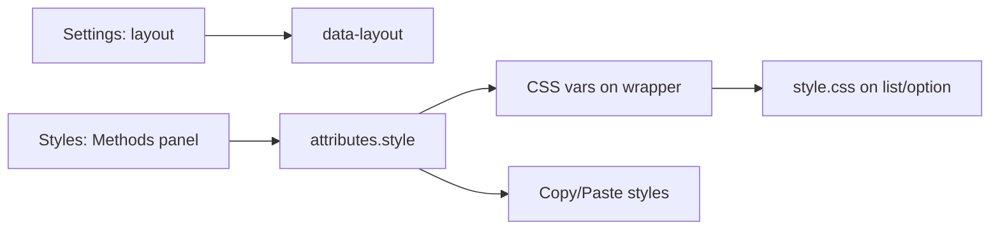

# Shipping Methods layout styles

> **For agentic workers:** execute tasks in order, one at a time. Steps use `- [ ]` for tracking.

**Status:** active
**Goal:** Merchant can tune gap, border radius, and method backgrounds (idle / selected / hover) per Shipping Methods layout from the Styles tab; values live on `style` so Copy/Paste styles works.
**Spec:** none, planned from the request (builds on [docs/plans/2026-10-09-shipping-methods-layouts.md](docs/plans/2026-10-09-shipping-methods-layouts.md); that plan’s `layoutSettings` path for visuals is superseded)
**Architecture:** Keep `layout` as a Settings attribute. Store visuals on the core `style` object (gap → `spacing.blockGap`, radius → `border.radius`, idle bg → `color.background`, selected/hover → `style.yaycheckout.backgroundSelected|backgroundHover`). Open the Styles tab via block `supports` with skipSerialization and default controls off so core panels do not fight custom UI. Custom `InspectorControls group="styles"` writes those paths. Editor and `render.php` print CSS variables on the wrapper; [style.css](../../packages/blocks/src/shipping-methods/style.css) consumes them with today’s hardcoded values as fallbacks. AJAX rate refresh leaves the wrapper (and vars) intact.
**Touches:** `packages/blocks/src/shipping-methods/*`, `includes/Renderer/CheckoutFragments.php` (style-var helper only)
**Tests:** none

## Requirements

- **Goal:** Styles tab panel “Methods” with layout-conditional controls; values persist on `style` and apply on storefront and editor preview.
- **Out of scope:** Border/divider color settings; typography; radio color; Free/Pro gating; changing layout markup.
- **Acceptance criteria:**
  1. Settings tab: Label + Layout only (no visual controls).
  2. Styles tab exists; panel Methods shows: gap only for check/columns/stacked; border radius for check/boxed/columns/stacked/default; three backgrounds for every layout. Divided has no gap/radius controls.
  3. Changing a control updates editor preview immediately via CSS variables on the wrapper.
  4. Storefront wrapper carries the same CSS variables; layout CSS uses them (fallbacks match current CSS when unset).
  5. Copy styles from one Shipping Methods block and paste onto another copies gap/radius/backgrounds; does not copy `layout`.
  6. Switching layout hides irrelevant controls but does not clear stored `style` values.
- **Decided with the user:** Visual settings in Styles tab custom panels; data on `style` (not `layoutSettings`) for Copy/Paste styles; gap for check/columns/stacked; radius for check/boxed/columns/stacked/default; three backgrounds for all layouts.

## Global constraints

- Product PHP must run on PHP 7.4: no enums, `match`, `readonly`, promoted constructor properties, `?->`, named arguments or union types.
- Never hand-edit `assets/dist/`; change sources and rebuild.
- TypeScript shapes that mirror PHP keep a `Mirrors ...` comment ([docs/conventions.md](../conventions.md)).
- Commit messages: Conventional Commits `type(scope): summary`.

## Review focus

- Paste styles must not change the target block’s `layout` value.
- Check/Divided with unset selected/hover bg must keep current look (no forced tint).
- Wrapper `style` must survive `update_order_review` (vars outside the rates fragment).

## Style contract

| Control key | Stored at | CSS variable | Layouts that show control |
|-------------|-----------|--------------|---------------------------|
| `gap` | `style.spacing.blockGap` | `--yaycheckout-shipping-gap` | check, columns, stacked |
| `borderRadius` | `style.border.radius` | `--yaycheckout-shipping-radius` | check, boxed, columns, stacked, default |
| `backgroundColor` | `style.color.background` | `--yaycheckout-shipping-bg` | all |
| `backgroundColorSelected` | `style.yaycheckout.backgroundSelected` | `--yaycheckout-shipping-bg-selected` | all |
| `backgroundColorHover` | `style.yaycheckout.backgroundHover` | `--yaycheckout-shipping-bg-hover` | all |

Fallbacks in CSS when a var is unset: gap `10px`; radius `12px` (check already uses 16px in CSS — keep check’s fallback `16px` in the check rules only); backgrounds keep current layout-specific rules (including selected tint via `color-mix` where CSS already does that).

`supports` in [block.json](../../packages/blocks/src/shipping-methods/block.json): enable `color.background`, `__experimentalBorder.radius`, `spacing.blockGap`, each with `__experimentalSkipSerialization: true` (or per-property skip) and `__experimentalDefaultControls` all `false` so the Styles tab opens without showing those core controls. Remove attribute `layoutSettings`.

---

### Task 0: Save this plan

**Files:**
- Create: `docs/plans/2026-10-09-shipping-methods-layout-styles.md` (this plan body)

- [ ] **Step 1: Write the plan file** from the approved plan content.
- [ ] **Step 2: Commit**

Stage: `docs/plans/2026-10-09-shipping-methods-layout-styles.md`
Message: `docs(plans): add Shipping Methods layout styles plan`

---

### Task 1: Supports, settings map, drop `layoutSettings`

**Files:**
- Modify: [packages/blocks/src/shipping-methods/block.json](../../packages/blocks/src/shipping-methods/block.json)
- Modify: [packages/blocks/src/shipping-methods/layouts.ts](../../packages/blocks/src/shipping-methods/layouts.ts)
- Modify: [packages/blocks/src/shipping-methods/setting-controls.tsx](../../packages/blocks/src/shipping-methods/setting-controls.tsx) (keys + types only if controls land in Task 2; at minimum export `ShippingSettingKey` union matching the table)
- Modify: [packages/blocks/src/shipping-methods/edit.tsx](../../packages/blocks/src/shipping-methods/edit.tsx) (stop reading/writing `layoutSettings`)

**Interfaces:**
- Produces: `SHIPPING_LAYOUTS[*].settings` lists per the Style contract table; `layoutSettings` gone from block.json and edit.

- [ ] **Step 1: Update `block.json`** — remove `layoutSettings`; add `supports` as in the Style contract.
- [ ] **Step 2: Fill each layout’s `settings` array** in `layouts.ts` per the table (`default` gets radius + three backgrounds; `divided` only three backgrounds; etc.).
- [ ] **Step 3: Strip `layoutSettings` from `edit.tsx`** — Settings panel keeps Label + Layout only.
- [ ] **Step 4: Verify**

Run: `nvm use && pnpm build:blocks`
Expected: build succeeds.

Open Shipping Methods in the editor: Styles tab is present; Settings has no layoutSettings UI.

- [ ] **Step 5: Commit**

Stage: the four files above
Message: `refactor(blocks): prepare Shipping Methods style supports`

---

### Task 2: Styles tab Methods panel

**Files:**
- Modify: [packages/blocks/src/shipping-methods/setting-controls.tsx](../../packages/blocks/src/shipping-methods/setting-controls.tsx)
- Modify: [packages/blocks/src/shipping-methods/edit.tsx](../../packages/blocks/src/shipping-methods/edit.tsx)
- Create if needed: `packages/blocks/src/shipping-methods/style-paths.ts` (get/set helpers for the five style paths; deep-merge `style` without wiping sibling keys)

**Interfaces:**
- Consumes: `layoutFor(layout).settings`, `SETTING_CONTROLS`
- Produces: controls that read/write `attributes.style` via the Style contract paths; rendered under `InspectorControls group="styles"` inside `PanelBody` title `Methods`

- [ ] **Step 1: Implement get/set helpers** for the five paths (gap as px string for `blockGap`; radius as px string or number per core border radius shape; colours as CSS colour strings).
- [ ] **Step 2: Implement `SETTING_CONTROLS`** — `RangeControl` for gap (0–48) and borderRadius (0–32); colour controls for the three backgrounds (WordPress `ColorPalette` / panel colour pattern already used in the repo).
- [ ] **Step 3: Wire Styles tab in `edit.tsx`** — `InspectorControls group="styles"` → PanelBody Methods → map `selectedLayout.settings` to controls; `onChange` merges into `style` only.
- [ ] **Step 4: Verify**

Action: select check → set gap and radius; switch to divided → gap/radius hidden, backgrounds still shown; switch back to check → previous gap/radius still set.
Expected: attributes in code editor show values under `style`, not `layoutSettings`.

- [ ] **Step 5: Commit**

Stage: setting-controls, edit, style-paths if created
Message: `feat(blocks): add Styles tab Methods controls for Shipping Methods`

---

### Task 3: Apply CSS variables on wrapper + consume in CSS

**Files:**
- Modify: [includes/Renderer/CheckoutFragments.php](../../includes/Renderer/CheckoutFragments.php) — add `shipping_methods_style_attribute( array $attributes ): string` (PHP 7.4-safe) that reads the Style contract paths, sanitizes (`wp_sanitize_block_gap_value` for gap; radius as non-negative length; colours via `sanitize_hex_color` or `safecss_filter_attr`), returns a `style` attribute value of only the `--yaycheckout-shipping-*` declarations that are set (empty string when none).
- Modify: [packages/blocks/src/shipping-methods/render.php](../../packages/blocks/src/shipping-methods/render.php) — pass that string into `HideWhenEmpty::wrapper( … 'style' => … )` when non-empty.
- Modify: [packages/blocks/src/shipping-methods/edit.tsx](../../packages/blocks/src/shipping-methods/edit.tsx) — same var map on `useBlockProps( { style: { …customProperties } } )` so the canvas matches.
- Modify: [packages/blocks/src/shipping-methods/style.css](../../packages/blocks/src/shipping-methods/style.css) — replace hardcoded gap/radius/background (and selected backgrounds) with `var(--yaycheckout-shipping-…, <current-fallback>)`; add `:hover` background using `--yaycheckout-shipping-bg-hover` where a method background applies (do not force hover tint when the var is unset — use fallback `transparent` or omit hover rule unless var is set; prefer fallback that preserves current look: idle/selected fallbacks equal today’s CSS, hover fallback `transparent`).

**Interfaces:**
- Produces: `CheckoutFragments::shipping_methods_style_attribute( array $attributes ): string`

- [ ] **Step 1: Implement PHP helper + wire `render.php`.**
- [ ] **Step 2: Mirror vars in editor `useBlockProps`.**
- [ ] **Step 3: Point `style.css` at the variables** with fallbacks; hover rule as above.
- [ ] **Step 4: Verify**

Run: `composer lint -- includes/Renderer/CheckoutFragments.php packages/blocks/src/shipping-methods/render.php`
Expected: no errors.

Run: `nvm use && pnpm build:blocks`
Expected: build succeeds.

Storefront: set gap on stacked, save layout, load checkout — method cards spaced by that gap; change selected background — selected row uses it; trigger a shipping totals refresh — spacing/colours remain (wrapper not replaced).

Copy styles from block A to block B (same layout or different): B’s methods pick up A’s gap/radius/colours; B’s `layout` unchanged.

- [ ] **Step 5: Commit**

Stage: CheckoutFragments.php, render.php, edit.tsx, style.css
Message: `feat(blocks): apply Shipping Methods layout styles via CSS variables`

---

## End-to-end check

Editor Styles → Methods controls respect layout visibility; storefront matches; Copy/Paste styles copies visuals only; AJAX refresh keeps styles.
