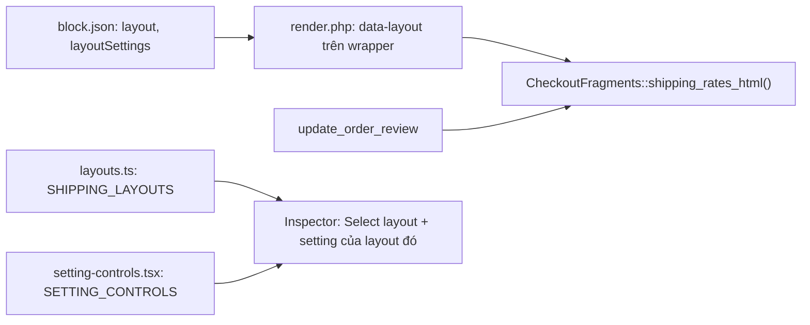

# Shipping Methods: tự in danh sách phí và ô chọn layout

**Status:** active
**Tests:** không thêm test. Phần này không nằm trong danh sách rủi ro cần test của CLAUDE.md; mỗi task có bước kiểm tra tay cụ thể.

## Yêu cầu

- Block Shipping Methods tự in danh sách phí trên storefront và trong editor. Không dùng bảng `shop_table` của Woo hay `wc_cart_totals_shipping_html()`. Vẫn giữ đúng cách chọn phương thức của Woo và các hook plugin dùng.
- Sidebar có ô **Layout**. Hiện chỉ có một lựa chọn là `Default`, tức kiểu hàng đang có.
- Mỗi layout khai báo danh sách setting nó dùng, lấy từ một bộ setting chung. Inspector chỉ hiện setting của layout đang chọn; giá trị của setting bị ẩn vẫn được giữ lại. `Default` chưa có setting nào: lần này chỉ dựng cơ chế.
- Phải chạy được trên PHP 7.4 (CLAUDE.md, quy tắc bắt buộc 4).

## Thiết kế



- `data-layout` nằm trên wrapper của block, do `render.php` in, chứ không nằm trong `.yaycheckout-shipping-methods__rates`. AJAX chỉ thay div rates, nên `shipping_rates_html()` không cần đọc lại attribute của block. Sau này setting cũng in thành biến CSS trên chính wrapper đó.
- Danh sách layout thuộc về PHP: `CheckoutFragments::SHIPPING_LAYOUTS`. TypeScript giữ một bản sao có comment `Mirrors ...` theo `docs/conventions.md`.
- Setting của mọi layout lưu chung trong một attribute object `layoutSettings`, khóa theo tên setting. Đổi layout không xóa giá trị nào.
- `layout` không khai `enum` trong `block.json`. PHP đưa giá trị lạ về `default`, nên thêm layout sau này không cần deprecation.

## Các file

- [includes/Renderer/CheckoutFragments.php](../../includes/Renderer/CheckoutFragments.php): in danh sách phí. Thêm `SHIPPING_LAYOUTS` và `shipping_layout()`.
- [packages/blocks/src/shipping-methods/render.php](../../packages/blocks/src/shipping-methods/render.php): in `data-layout` trên wrapper.
- [packages/blocks/src/shipping-methods/block.json](../../packages/blocks/src/shipping-methods/block.json): attribute `layout` và `layoutSettings`.
- [packages/blocks/src/shipping-methods/style.css](../../packages/blocks/src/shipping-methods/style.css): selector theo class riêng của plugin.
- [packages/blocks/src/shipping-methods/edit.tsx](../../packages/blocks/src/shipping-methods/edit.tsx): bản xem trước dùng cùng markup; inspector có ô Layout và các setting của layout.
- Tạo mới `packages/blocks/src/shipping-methods/layouts.ts` và `packages/blocks/src/shipping-methods/setting-controls.tsx`.
- [docs/architecture.md](../architecture.md): mục Storefront, phần fragment.

## Task 0: tạo nhánh

- `git switch -c onyx/feat/shipping-methods-layouts` từ `dev/edd`. Thay đổi chưa commit trong `CheckoutFragments.php`, `edit.tsx` và `style.css` đi theo sang nhánh mới.
- Lưu plan này thành `docs/plans/2026-10-09-shipping-methods-layouts.md`.

## Task 1: hoàn tất danh sách phí tự in

Phần lớn đã có trong working tree. Task này chốt lại và commit.

- `shipping_rates_html()` in ra:
  - `woocommerce_review_order_before_shipping`;
  - mỗi package một `div.yaycheckout-shipping-methods__package`;
  - `woocommerce_review_order_after_shipping`.
  
  Output của hai hook review-order chỉ được bọc vào `table.yaycheckout-shipping-methods__extensions` khi có plugin in ra gì đó.
- Mỗi rate là một `li.yaycheckout-shipping-methods__option`, gồm:
  - input `shipping_method[i]`, có `data-index`, `id`, `value` và class `shipping_method` như Woo; nhiều phương thức là radio, một phương thức là hidden;
  - `label` chứa `__indicator`, `__body > __name` và `__price`;
  - sau đó `do_action( 'woocommerce_after_shipping_rate', $method, $index )`.
- Filter `woocommerce_cart_shipping_method_full_label` chạy trên tên phương thức. Giá in riêng bằng `shipping_rate_price_html()`, cùng quy tắc thuế và quy tắc ẩn giá $0 cho free shipping và local pickup như `wc_cart_totals_shipping_method_label()`.
- Không có rate thì in hai câu của Woo qua `woocommerce_shipping_may_be_available_html` và `woocommerce_no_shipping_available_html`. Có từ hai package thì in chi tiết package qua `woocommerce_shipping_package_details_array`.
- `style.css`: đổi mọi selector `#shipping_method > li` sang `.yaycheckout-shipping-methods__list > .yaycheckout-shipping-methods__option`. Markup vẫn giữ `id="shipping_method"` và class `woocommerce-shipping-methods`, chỉ để script của plugin khác còn tìm thấy.
- `docs/architecture.md`: thêm vào mục "Extra fields and fragments" rằng Shipping Methods tự in danh sách, giữ những hook Woo nào, và filter label chỉ nhận tên phương thức, không kèm giá.
- **Kiểm tra:**
  - `composer lint -- includes/Renderer/CheckoutFragments.php` không báo lỗi.
  - `nvm use && pnpm build:blocks` build xong.
  - Trên checkout có từ 2 phương thức: đổi radio thì Total trong Order Summary đổi theo, và tải lại trang vẫn giữ phương thức đã chọn.
  - Chỉ còn 1 phương thức: hàng đó có viền primary và không có radio.
  - Xóa địa chỉ: hiện "Enter your address to view shipping options."
- **Commit** `CheckoutFragments.php`, `style.css`, `edit.tsx`, `docs/architecture.md` và file plan với message `feat(blocks): render shipping rates without WooCommerce's table`.

## Task 2: attribute layout và data-layout

- `block.json`: thêm `"layout": { "type": "string", "default": "default" }` và `"layoutSettings": { "type": "object", "default": {} }`.
- `CheckoutFragments`:
  - `public const SHIPPING_LAYOUTS = [ 'default' ];`
  - `public static function shipping_layout( array $attributes ): string` trả về `$attributes['layout']` nếu giá trị nằm trong `SHIPPING_LAYOUTS`, ngược lại trả `'default'`.
- `render.php`: thêm `'data-layout' => CheckoutFragments::shipping_layout( $attributes )` vào mảng truyền cho `HideWhenEmpty::wrapper()`.
- `edit.tsx`: `useBlockProps` nhận thêm `'data-layout': layout || 'default'`.
- **Kiểm tra:**
  - Wrapper của block trên storefront có `data-layout="default"`.
  - Sửa tay `"layout":"xyz"` trong code editor rồi lưu: storefront vẫn in `default`.
  - Lint và build như Task 1.
- **Commit** `block.json`, `render.php`, `CheckoutFragments.php`, `edit.tsx` với message `feat(blocks): add layout attribute to Shipping Methods`.

## Task 3: ô chọn layout và setting theo layout

`layouts.ts`:

```ts
/** Mirrors CheckoutFragments::SHIPPING_LAYOUTS in PHP. */
export const SHIPPING_LAYOUTS: ShippingLayout[] = [
	{ value: 'default', label: __( 'Default', 'yaycheckout' ), settings: [] },
];
export interface ShippingLayout { value: string; label: string; settings: ShippingSettingKey[] }
export function layoutFor( value: string | undefined ): ShippingLayout; // không tìm thấy thì trả SHIPPING_LAYOUTS[0]
```

`setting-controls.tsx`, bộ setting chung:

```ts
export type ShippingSettingKey = keyof typeof SETTING_CONTROLS;
export interface SettingControlProps { value: unknown; onChange: ( value: unknown ) => void }
export const SETTING_CONTROLS = {} satisfies Record< string, ComponentType< SettingControlProps > >;
```

Thêm một setting sau này gồm: một entry trong `SETTING_CONTROLS`, khóa của nó trong `settings` của layout cần dùng, và biến CSS do `render.php` in ra.

`edit.tsx`:

- Trong `PanelBody` có sẵn, thêm `SelectControl` "Layout" lấy options từ `SHIPPING_LAYOUTS`, ghi vào `layout`.
- Bên dưới, render `layoutFor( layout ).settings.map( key => SETTING_CONTROLS[ key ] )` với `value = layoutSettings[ key ]`. `onChange` ghi `{ layoutSettings: { ...layoutSettings, [ key ]: v } }`, không đụng các khóa khác.
- Danh sách rỗng thì không render gì, kể cả tiêu đề.

**Kiểm tra:**

- Chọn block trong editor: sidebar có ô Layout, chỉ một lựa chọn là Default, bên dưới không có setting nào.
- Đổi Label rồi lưu và tải lại: không có cảnh báo block invalid.
- `pnpm build:blocks` build xong.

**Commit** `layouts.ts`, `setting-controls.tsx`, `edit.tsx` với message `feat(blocks): add layout picker with per-layout settings to Shipping Methods`.

## Điểm cần chú ý khi review

- Plugin nào đọc giá ngay trong chuỗi `woocommerce_cart_shipping_method_full_label` sẽ không thấy giá ở đó. Đây là khác biệt có chủ ý, ghi trong `docs/architecture.md`.
- Plugin in `<tr>` qua hook review-order shipping: các dòng đó nằm trong bảng riêng dưới danh sách. Kiểm tra lại sau khi đổi radio, vì div rates được thay khi refresh.
- Node phải là bản 22 (`nvm use`). Node 18 vẫn build được nhưng pnpm cảnh báo; xem `docs/known-issues.md`.
